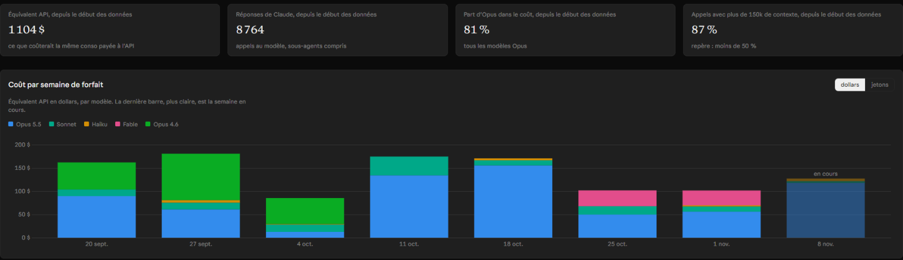
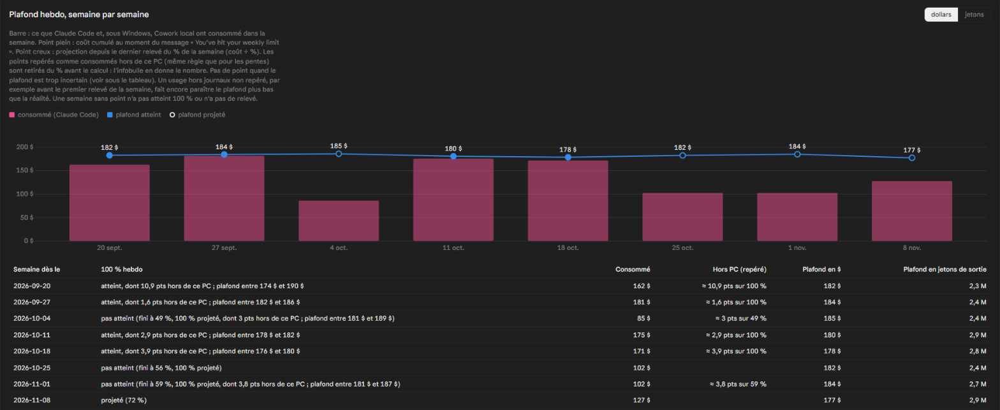
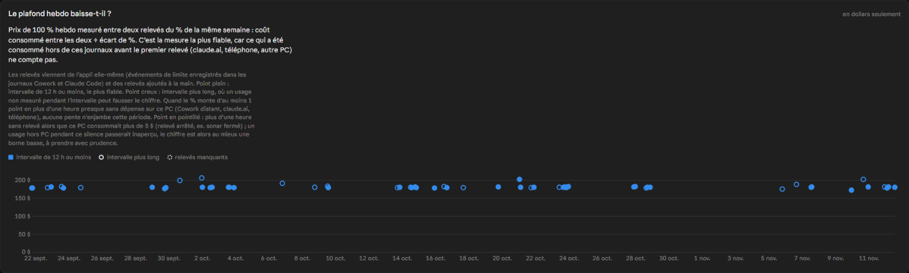

# conso-tokens

[English](README.md) · **Français**

Un tableau de bord local de votre usage de Claude Code : ce que vos sessions coûteraient au tarif public de l'API, par
semaine de forfait, par jour, par dossier de travail, par modèle et par session, plus une estimation du **plafond hebdo
de votre forfait en dollars**, tirée du pourcentage d'usage qu'affiche l'appli.

Il ne lit que les compteurs de jetons et les horodatages des journaux de Claude Code (et, sous Windows, de Cowork local si présents) de votre machine, **jamais le
contenu de vos conversations**, et tout reste sur votre machine (sauf ce que vous choisissez de publier).

Projet compagnon : [**sonar**](https://github.com/Gh0st113/sonar), un mod pour l'onglet Code de Claude Desktop. Son
journal de quota (`~/.claude/sonar/quota-log.jsonl`) donne à ce tableau les relevés de pourcentage dont il a besoin pour
estimer le plafond hebdo. Sans sonar, seuls les relevés écrits dans les journaux de Claude Code servent, et jusqu'à fin octobre 2026 ceux de Cowork local (moins nombreux).



<sub>Captures faites avec des **données simulées** (voir [Essayer avec des données simulées](#essayer-avec-des-données-simulées)), pas un usage réel.</sub>

## Ce que vous obtenez

- Coût par semaine de forfait, empilé par modèle (la légende suit les modèles présents dans vos journaux).
- Coût par jour, par dossier, par modèle, les 30 sessions les plus chères ; bouton « dollars / jetons » sur la plupart des
  graphiques de coût (les pentes restent en dollars, le tableau des plafonds donne les deux unités, le graphique du contexte compte des appels).
- Plafond hebdo : prix de 100 % de la limite hebdo, mesuré entre deux relevés de la même semaine, et semaine par semaine
  (atteint, projeté ou trop incertain), avec l'usage fait hors de ce PC (claude.ai, téléphone, Cowork distant) repéré et
  retiré quand le pourcentage monte sans dépense ici.
- Taille du contexte à chaque appel (part des appels au-delà de 150k jetons).
- Contrôles de cohérence après chaque export : une ligne, `CONTRÔLES : OK`, ou la liste précise de ce qui cloche.





## Prérequis

- Node.js 20 ou plus, rien à installer.
- Les journaux de Claude Code dans `~/.claude/projects` (sous Windows, les sessions locales de Cowork sont lues **si présentes** ; depuis fin octobre 2026, Cowork n'en écrit plus sur le PC : son usage passe dans le hors PC, déduit ; pas
  sous macOS ni Linux).

## Utilisation

```
git clone https://github.com/Gh0st113/conso-tokens
cd conso-tokens
node agreger.mjs        # lit les journaux → donnees/donnees.json (et une archive des compteurs)
node exporter.mjs       # → donnees/export/*.json (11 tables) + la ligne CONTRÔLES
node --test             # tests
```

Chemins donnés pour le dossier de données par défaut `donnees/` (ignoré par git) ; avec `dossierDonnees`, regarder là.

`node --test` lance les tests du lecteur de tarifs, puis vérifie vos propres données exportées : ces tests sont sautés
tant que les deux commandes ci-dessus n'ont pas tourné, et chacun de ceux qui demandent plus d'historique que vous n'en
avez (plusieurs semaines, quelques pentes) l'est aussi. Un test de données en échec signale un export incohérent : lire
son message.

Réglages facultatifs : copier `config.exemple.json` en `config.local.json` (ignoré par git) :

| Clé | Rôle |
|---|---|
| `dossierDonnees` | où vont les données (défaut `donnees/` dans ce dossier ; `~/…` accepté). Hors du dépôt, c'est plus sûr |
| `motifProjet` | expression régulière dont le groupe 1 tire un nom court de dossier de la clé des journaux |
| `renommerProjets` | `[[expression, nom], …]` testés d'abord, par ex. pour afficher un dossier sensible sous un nom neutre |
| `remiseAZero` | jour et heure UTC de la remise à zéro hebdo : `{ "jour": "lundi", "heureUTC": "08:00" }` (nom du jour en français ou en anglais, `HH:MM`). Défaut : dimanche 10:00 UTC. Un changement redécoupe tout l'historique : les clés de `resets` doivent alors être des débuts de semaine du nouveau cycle |
| `resets` | resets de limite utilisés, deux formes (voir ci-dessous) : `{ "AAAA-MM-JJ": "quand" }` (semaine entière) ou une liste `[{ "quand": "AAAA-MM-JJTHH:MMZ", "type": "hebdo", "note": "…" }]` (heure exacte, découpage) |
| `trous` | périodes dont vous savez que les journaux manquent : `[["premier jour", "dernier jour", "raison"]]` |

**Resets de limite** (`resets`). L'ancienne forme (objet `{ "AAAA-MM-JJ": "quand" }`) marque la semaine entière comme « reset utilisé », sans plafond : c'est le comportement d'origine. La nouvelle forme donne l'heure exacte, en UTC, avec le `Z` :

```json
"resets": [{ "quand": "2026-01-06T19:30Z", "type": "hebdo", "note": "reset utilisé le mardi soir" }]
```

- `quand` (obligatoire) : `AAAA-MM-JJTHH:MMZ`. Les secondes sont refusées, comme une date sans `Z`.
- `type` (obligatoire) : seul `"hebdo"` est accepté pour l'instant.
- `note` (facultatif) : texte libre affiché dans la page.

Une valeur invalide arrête le script avec un message `config.local.json : resets…`. Avec la nouvelle forme, **la semaine est découpée** en segments, un par reset : le plafond et la sortie de la semaine sont calculés sur le segment retenu (celui qui a le plus grand % local, à égalité le plus récent), avec son propre coût ; les pentes ne relient jamais deux segments ; le statut de la semaine indique la coupure. Hypothèse retenue : un reset à la demande ne déplace pas la fin de la semaine (un seul cas observé).

**Détection** : si le % hebdo baisse de 3 points ou plus sans reset déclaré, et que le relevé suivant confirme la baisse, `CONTRÔLES` signale `reset probable … non déclaré dans « resets »`. Une baisse isolée (un seul relevé) n'est pas signalée. Rien n'est corrigé automatiquement. Limite : la détection compare avec le plus haut % de toute la semaine, donc un reset déclaré peut faire signaler à tort la baisse qui suit (à traiter avant la fusion).

Journaux d'un autre PC : `node agreger.mjs --journaux <chemin vers son .claude/projects>` (répétable).

**Relevés à la main** (facultatif) : sans sonar, vous pouvez noter vous-même les pourcentages d'usage dans
`releves.json`, dans le dossier des données : une liste de relevés en UTC (`hebdo` = % hebdo, `cinqH` = % sur 5 h, chacun
avec l'heure de remise à zéro affichée par l'appli) :

```json
[{ "ts": "2026-01-07T18:30:00Z", "hebdo": 42, "hebdoReset": "2026-01-11T10:00:00Z", "cinqH": 15, "cinqHReset": "2026-01-07T21:00:00Z" }]
```

Un pourcentage sous 10 est ignoré (trop bruité) ; l'autre du même relevé sert quand même. Un fichier illisible est signalé puis ignoré.

**Tarifs** : `tarifs.json` reprend tous les modèles de la [page de prix](https://platform.claude.com/docs/en/about-claude/pricing)
officielle. Quand un modèle sort ou change de prix, lancer `node maj-tarifs.mjs` : il relit la page et n'écrit rien si
elle n'a pas la forme attendue.

Claude Code efface par défaut les sessions non modifiées depuis 30 jours (`cleanupPeriodDays`). L'archive des compteurs
garde chaque réponse déjà comptée, mais une réponse n'est comptée que si son journal existait au moment du passage :
augmentez ce réglage pour un long historique.

## Afficher le tableau

`page/index.html` est la page d'un **artefact Dashboard de claude.ai**, pas une page web autonome : elle s'appuie sur la
bibliothèque de graphiques et le chargeur de données fournis par claude.ai, donc **l'ouvrir directement dans un
navigateur n'affiche rien**.

1. Dans l'appli Claude, ouvrir l'onglet **Code** dans ce dossier.
2. Demander : *« Crée un artefact Dashboard privé à partir de `page/index.html`, avec comme données les 11 fichiers de
   `donnees/export/`, chacun nommé comme son fichier »* (`semaines`, `jours`, `projets`, `modeles`, `sessions`, `types`,
   `contexte`, `plafondsHebdo`, `plafonds5h`, `pentes`, `reglages`).
3. Après chaque nouvel export : *« Recharge les 11 données de mon tableau depuis `donnees/export/` »*.

Gardez l'artefact privé : qui l'ouvre peut lire les fichiers (noms de dossiers, coûts, sessions).

## Essayer avec des données simulées

`demo/generer-demo.mjs` écrit un faux dossier personnel : huit semaines de journaux Claude Code (dossiers inventés,
tirage à graine fixe) et le journal de quota sonar qui va avec, pour un plafond hebdo d'environ 180 $. C'est ainsi
qu'ont été faites les captures ci-dessus. À lancer dans une **copie** de ce dépôt sans `config.local.json`, pour que
les résultats aillent dans le `donnees/` de la copie et pas dans votre dossier de données :

```powershell
node demo/generer-demo.mjs ../demo-home
$env:USERPROFILE = (Resolve-Path ../demo-home); node agreger.mjs; node exporter.mjs
```

Sous macOS / Linux : `HOME=../demo-home node agreger.mjs && HOME=../demo-home node exporter.mjs`. Afficher ensuite
`donnees/export/` comme décrit plus haut. Fermer cette fenêtre PowerShell après coup (son `USERPROFILE` est modifié).

## Limites

- L'« équivalent API » est un ordre de grandeur pour comparer les semaines, ni la facturation du forfait ni le % de `/usage`.
- La remise à zéro hebdo se règle par la clé `remiseAZero` (défaut : **dimanche 10:00 UTC**), un seul cycle pour tout
  l'historique. Les jours calendaires restent au fuseau **Europe/Paris**, non réglable.
- L'usage hors de ce PC est déduit de pourcentages entiers, pas mesuré : quand de telles périodes sont repérées, le
  plafond hebdo est donné en fourchette, sinon en estimation unique ; aucun plafond quand la part payée sur ce PC est sous
  10 % ou que la fourchette dépasse 25 % du plafond.
- Limites connues de la détection de reset : les relevés sous 10 % sont ignorés, donc une baisse qui laisse le % sous 10 jusqu'à la fin de la semaine n'est pas signalée ; une ligne de relevé aberrante isolée reste dans les pentes.

## Licence

MIT
