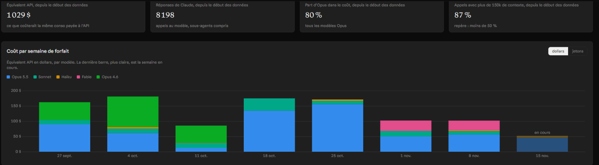
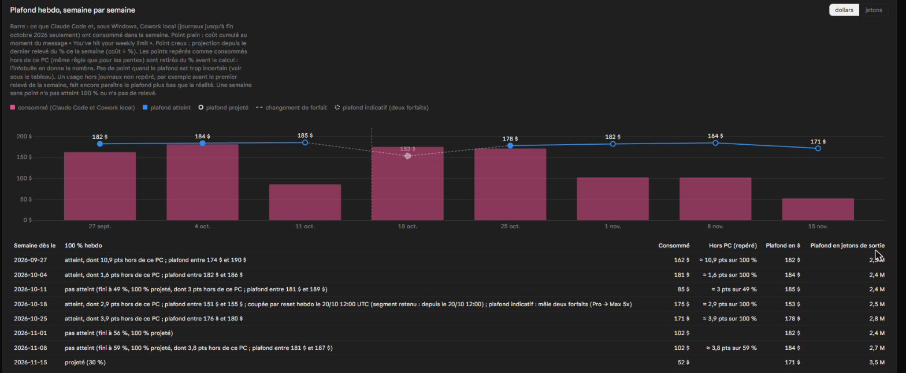
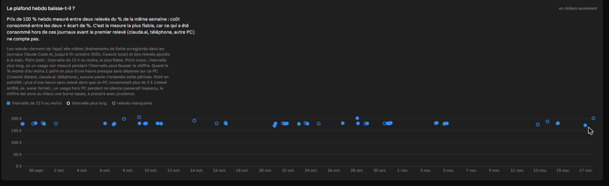

# conso-tokens

[English](README.md) · **Français**

Un tableau de bord local de votre usage de Claude Code : ce que vos sessions coûteraient au tarif public de l'API, par
semaine de forfait, par jour, par dossier de travail, par modèle et par session, plus une estimation du **plafond hebdo
de votre forfait en dollars**, tirée du pourcentage d'usage qu'affiche l'appli.

Il ne lit que les compteurs de jetons et les horodatages des journaux de Claude Code (et, sous Windows, de Cowork local si présents) de votre machine, **jamais le
contenu de vos conversations**, et tout reste sur votre machine (sauf ce que vous choisissez de publier).

La page du tableau de bord existe en français et en anglais : un bouton FR / EN la change, et par défaut elle suit la langue du navigateur. Le code, les commentaires et les sorties de console restent en français.

Projet compagnon : [**sonar**](https://github.com/Gh0st113/sonar), un mod pour l'onglet Code de Claude Desktop. Son
journal de quota (`~/.claude/sonar/quota-log.jsonl`) donne à ce tableau les relevés de pourcentage dont il a besoin pour
estimer le plafond hebdo. Sans sonar, seuls les relevés écrits dans les journaux de Claude Code servent, et jusqu'à fin octobre 2026 ceux de Cowork local (moins nombreux).



<sub>Captures faites avec des **données simulées** (voir [Essayer avec des données simulées](#essayer-avec-des-données-simulées)), pas un usage réel.</sub>

## Ce que vous obtenez

- Coût par semaine de forfait, empilé par modèle (la légende suit les modèles présents dans vos journaux).
- Coût par jour, par dossier, par modèle, les 30 sessions les plus chères ; bouton « dollars / jetons » sur la plupart des
  graphiques de coût (les pentes restent en dollars, le tableau des plafonds donne les deux unités, le graphique du contexte compte des appels).
- Plafond hebdo : prix de 100 % de la limite hebdo, mesuré entre deux relevés de la même semaine, et semaine par semaine
  (atteint, projeté ou trop incertain), avec l'usage fait hors de ce PC (claude.ai, téléphone, Cowork distant) repéré et
  retiré quand le pourcentage monte sans dépense ici.
- Taille du contexte à chaque appel (part des appels au-delà de 150k jetons).
- Où partent les jetons : part de la lecture du cache, de l'écriture en cache, de la sortie et de l'entrée neuve, en
  volume et en coût.
- Les vues par dossier, par modèle, du contexte, des types de jetons, des reconstructions du cache et des sessions
  suivent un même choix de période : 7 jours, 30 jours ou tout.
- Jetons du conseiller (advisor : Fable, Mythos…) comptés sous son propre modèle, à côté du modèle principal de la réponse.
- Contrôles de cohérence après chaque export : une ligne, `CONTRÔLES : OK`, ou la liste précise de ce qui cloche.





## Prérequis

- Node.js 20 ou plus, aucune dépendance à installer.
- Les journaux de Claude Code dans `~/.claude/projects` (sous Windows, les sessions locales de Cowork sont lues **si présentes** ; depuis fin octobre 2026, Cowork n'en écrit plus sur le PC : son usage passe dans le hors PC, déduit ; pas
  sous macOS ni Linux).

## Installation

**Avec npm** (le plus simple, sans clone). Réglages et données vont dans `~/.conso-tokens/` :

```
npm install -g conso-tokens
conso-tokens update     # lit les journaux et prépare les données du tableau de bord
conso-tokens page       # où sont la page du tableau de bord et ses données
```

Mise à jour ensuite par `npm update -g conso-tokens`. Sous Windows, si PowerShell refuse de lancer `conso-tokens`, taper
plutôt `conso-tokens.cmd` (voir [En commande](#en-commande-conso-tokens)). Ensuite : [Afficher le tableau](#afficher-le-tableau). Vous utilisiez déjà un clone ?
Lire d'abord « Passer d'un clone au paquet » dans [En commande](#en-commande-conso-tokens).

**Depuis un clone**, pour lire ou modifier le code, ou lancer les tests : voir [Utilisation](#utilisation) juste en dessous.

## Utilisation

Depuis un clone :

```
git clone https://github.com/Gh0st113/conso-tokens
cd conso-tokens
node agreger.mjs        # lit les journaux → data/donnees.json (et une archive des compteurs)
node exporter.mjs       # → data/export/*.json (14 tables) + la ligne CONTRÔLES
node --test             # tests
```

Chemins donnés pour le dossier de données par défaut `data/` (ignoré par git). Un clone qui a déjà un dossier `donnees/`
continue de l'utiliser, sans rien changer ; avec `dataDir`, regarder là.

### En commande (`conso-tokens`)

Les mêmes scripts se lancent aussi en une seule commande, depuis n'importe quel dossier, une fois installés avec npm
(voir [Installation](#installation)). Depuis un clone, `npm link` (une fois, dans le clone) met plutôt `conso-tokens`
dans le PATH ; le code, `config.local.json` et `data/` restent dans le clone.

```
conso-tokens update     # agreger puis exporter (exporter n'est pas lancé si agreger échoue)
conso-tokens aggregate  # mêmes options que node agreger.mjs (--logs, --output, --quota-log, …)
conso-tokens export
conso-tokens prices     # node maj-tarifs.mjs
conso-tokens page       # chemin de la page du tableau de bord et du dossier export/
conso-tokens help       # la liste des commandes
```

Les anciens noms français marchent toujours : `maj`, `agreger`, `exporter`, `tarifs`, `aide`, et les options `--journaux`,
`--sortie`, `--journal-quota` ; de même les anciennes clés de `config.local.json` (voir plus bas). Rien à renommer.

**Où vont réglages et données.** Lancé depuis un clone (un dossier qui contient `.git`, `config.local.json` ou `donnees/`),
rien ne change : tout reste dans le clone. Installé en paquet, `config.local.json`, `data/` et le `tarifs.json` mis à
jour vont dans `~/.conso-tokens/`, pour qu'une mise à jour du paquet n'y touche jamais. La variable d'environnement
`CONSO_TOKENS_DIR` remplace ce dossier dans les deux cas. Si le dossier contient à la fois `data/` et `donnees/` sans
`dataDir` (ni `dossierDonnees`), les commandes de données (`update`, `aggregate`, `export`) s'arrêtent avant d'écrire
quoi que ce soit : n'en garder qu'un.

**Passer d'un clone au paquet** : **avant** le premier `conso-tokens update`, copier le `config.local.json` du clone dans
`~/.conso-tokens/`. Si ses données étaient dans le dossier `data/` (ou `donnees/`) du clone, ou à un `dataDir` relatif,
copier aussi ce dossier de données (dans `~/.conso-tokens/data/`, ou au même endroit relatif) ; un `dataDir` absolu ou en
`~/…` continue de viser les mêmes données. Si vous avez lancé `node maj-tarifs.mjs` dans
le clone, copier aussi son `tarifs.json` : il garde le prix des modèles retirés depuis de la page Pricing. L'archive des compteurs de `data/` garde des réponses dont
Claude Code a depuis effacé les journaux : une archive neuve ne peut pas les retrouver. Le premier passage sans archive
le signale.

**Windows** : si PowerShell refuse d'exécuter des scripts (stratégie d'exécution), il refuse aussi le lanceur
`conso-tokens.ps1` créé par npm : taper `conso-tokens.cmd` à la place (et `npm.cmd link`).

`node --test` lance les tests des calculs et des phrases de la page (sur de petits exemples écrits à la main) et
du lecteur de tarifs, puis vérifie vos propres données exportées : ces tests sont sautés
tant que les deux commandes ci-dessus n'ont pas tourné, et chacun de ceux qui demandent plus d'historique que vous n'en
avez (plusieurs semaines, quelques pentes) l'est aussi. Un test de données en échec signale un export incohérent : lire
son message.

Contrôle croisé facultatif, depuis un clone seulement (absent du paquet npm) : `node comparer-ccusage.mjs` (après `agreger.mjs`) lance [ccusage](https://github.com/ryoppippi/ccusage)
(version figée, téléchargée par `npx` la première fois : il faut le réseau) sur les mêmes journaux et affiche
`CCUSAGE : OK` ou chaque jour dont les jetons diffèrent. Il n'écrit rien. ccusage qui compte moins sur des jours anciens
est attendu (journaux effacés gardés dans l'archive, `--logs`, Cowork local), comme un peu moins d'écriture cache sur
les réponses avec conseiller (la version figée précède la correction de ccusage) ; ccusage qui compte plus signale des
réponses que ce tableau de bord ne compte pas.

Réglages facultatifs : copier `config.exemple.json` en `config.local.json` (ignoré par git) :

| Clé (ancien nom accepté entre parenthèses) | Rôle |
|---|---|
| `dataDir` (`dossierDonnees`) | où vont les données (défaut `data/` à côté de `config.local.json`, ou `donnees/` s'il est seul à exister ; `~/…` accepté, un chemin relatif part du dossier de `config.local.json`). Hors du dépôt, c'est plus sûr |
| `projectPattern` (`motifProjet`) | expression régulière dont le groupe 1 tire un nom court de dossier de la clé des journaux |
| `renameProjects` (`renommerProjets`) | `[[expression, nom], …]` testés d'abord, par ex. pour afficher un dossier sensible sous un nom neutre |
| `weeklyReset` (`remiseAZero`) | jour et heure UTC de la remise à zéro hebdo : `{ "day": "monday", "hourUTC": "08:00" }` (nom du jour en français ou en anglais, `HH:MM`). Défaut : dimanche 10:00 UTC. Un changement redécoupe tout l'historique : les clés de `resets` doivent alors être des débuts de semaine du nouveau cycle |
| `resets` | resets de limite utilisés, deux formes (voir ci-dessous) : `{ "AAAA-MM-JJ": "quand" }` (semaine entière) ou une liste `[{ "when": "AAAA-MM-JJTHH:MMZ", "type": "weekly", "note": "…" }]` (heure exacte, découpage) |
| `gaps` (`trous`) | périodes dont vous savez que les journaux manquent : `[["premier jour", "dernier jour", "raison"]]` |
| `plans` (`forfaits`) | changements de forfait déclarés à la main : `{ "AAAA-MM-JJ": "forfait" }`, appliqués à toute la semaine qui contient la date (voir ci-dessous) |
| `cache` | reconstructions du cache, pour la conversation principale (`main`) et les sous-agents (`subagents`) : `{ "main": { "ttl": "auto", "minWrite": 20000 }, "subagents": { "ttl": "auto", "minWrite": 10000 } }` (les défauts). `ttl` : `auto` lit la durée du cache dans les journaux, appel par appel (5 min l'emporte si un appel écrit les deux), `5m` ou `1h` la force ; `minWrite` : jetons écrits en cache à partir desquels un cache perdu compte comme reconstruction. Une reconstruction est une réponse qui relit moins de la moitié du contexte de la réponse précédente de son fil ; cause, dans cet ordre : compactage du fil (écriture du résumé, inévitable, montrée à part des pertes), pause plus longue que le cache, changement de modèle, consignes ou outils changés (ligne `api-request-shape` d’empreinte différente, le plus souvent des outils chargés en cours de session), autre |

Chaque réglage s'écrit sous son nom anglais **ou** son ancien nom français, pas les deux : les donner tous les deux arrête
le script avec un message qui les nomme. Dans `weeklyReset`, `day` et `hourUTC` (ou `jour` et `heureUTC`) peuvent se
mélanger, mais pas deux noms pour un même champ.

**Resets de limite** (`resets`). L'ancienne forme (objet `{ "AAAA-MM-JJ": "quand" }`) marque la semaine entière comme « reset utilisé », sans plafond : c'est le comportement d'origine. La nouvelle forme donne l'heure exacte, en UTC, avec le `Z` :

```json
"resets": [{ "when": "2026-01-06T19:30Z", "type": "weekly", "note": "reset utilisé le mardi soir" }]
```

- `when` (obligatoire ; ancien nom `quand`) : `AAAA-MM-JJTHH:MMZ`. Les secondes sont refusées, comme une date sans `Z`.
- `type` (obligatoire) : `"weekly"` (ou l'ancien `"hebdo"`) ; seul ce type est accepté pour l'instant.
- `note` (facultatif) : texte libre affiché dans la page.

Une valeur invalide arrête le script avec un message `config.local.json : resets…`. Avec la nouvelle forme, **la semaine est découpée** en segments, un par reset : le plafond et la sortie de la semaine sont calculés sur le segment retenu (celui qui a le plus grand % local, à égalité le plus récent), avec son propre coût ; les pentes ne relient jamais deux segments ; le statut de la semaine indique la coupure. Hypothèse retenue : un reset à la demande ne déplace pas la fin de la semaine (un seul cas observé).

**Détection** : si le % hebdo baisse de 3 points ou plus sans reset déclaré, et que le relevé suivant confirme la baisse, `CONTRÔLES` signale `reset probable … non déclaré dans « resets »`. Une baisse isolée (un seul relevé) n'est pas signalée. Rien n'est corrigé automatiquement. Le plus haut % est pris dans le segment seulement : un reset déclaré remet le maximum à zéro pour les relevés qui le suivent.

**Changements de forfait** (`plans`, ancien nom `forfaits`). Le forfait (Pro, Max 5x…) n'est **pas détecté automatiquement** : les journaux ne le contiennent pas, et aucun fichier d'identifiants n'est lu. Déclarez chaque changement vous-même, avec le premier jour du nouveau forfait ; toute la semaine qui contient ce jour est le nouveau forfait :

```json
"plans": { "2026-01-04": "Pro", "2026-01-13": "Max 5x" }
```

- La semaine d'une date suit l'heure de remise à zéro de ce jour-là : avec le cycle par défaut (dimanche 10:00 UTC), un jour de remise à zéro appartient à la **nouvelle** semaine, quelle que soit l'heure du cycle.
- Le libellé est un texte libre : 1 à 40 caractères, lettres, chiffres, espaces et `. + -` (ni parenthèse ni `%`, qui rendraient la phrase du statut ambiguë). Les espaces de bord sont ignorés, et `Pro` / `pro` désignent le même forfait. Le libellé **est publié sur la page** : n'y mettez jamais un nom personnel (employeur, client…).
- Un **changement** (libellé différent de l'entrée précédente) fait de sa semaine une *semaine de changement*. Son plafond est calculé comme d'habitude mais marqué `plafond indicatif : mêle deux forfaits (A → B)` : la semaine mêle deux limites, le chiffre est affiché mais **jamais comparé** aux autres semaines (ni dans la bande de plausibilité, ni dans la ligne du plafond de la page). Pour un plafond propre à cette semaine, déclarez l'heure du changement comme reset précis dans `resets` : la semaine est alors coupée, et la marque « indicatif » reste.
- Les semaines avant la première entrée n'ont pas de forfait : elles forment un groupe à part dans la bande de plausibilité. Sans la clé, rien ne change.
- Forfaits **Team** : la limite dépend du siège (Standard ou Premium) ; écrivez-le dans le libellé (`"Team Premium"`). **Enterprise** (usage au tarif de l'API) et tout forfait sans limite hebdo en % : sans relevé de %, aucun plafond n'est estimé ; le tableau montre le montant consommé, comme avant.
- Une entrée invalide arrête le script avec un message `config.local.json : forfaits…`.

Journaux d'un autre PC : `node agreger.mjs --logs <chemin vers son .claude/projects>` (répétable ; `--journaux` marche toujours).

**Relevés à la main** (facultatif) : sans sonar, vous pouvez noter vous-même les pourcentages d'usage dans
`readings.json` (ancien nom `releves.json`, toujours lu ; garder un seul des deux noms, sinon le script s'arrête), dans le dossier des données : une liste de relevés en UTC (`hebdo` = % hebdo, `cinqH` = % sur 5 h, chacun
avec l'heure de remise à zéro affichée par l'appli) :

```json
[{ "ts": "2026-01-07T18:30:00Z", "hebdo": 42, "hebdoReset": "2026-01-11T10:00:00Z", "cinqH": 15, "cinqHReset": "2026-01-07T21:00:00Z" }]
```

Un pourcentage sous 10 est ignoré (trop bruité) ; l'autre du même relevé sert quand même. Un fichier illisible est signalé puis ignoré.

**Tarifs** : `tarifs.json` reprend tous les modèles de la [page de prix](https://platform.claude.com/docs/en/about-claude/pricing)
officielle. Quand un modèle sort ou change de prix, lancer `node maj-tarifs.mjs` : il relit la page et n'écrit rien si
elle n'a pas la forme attendue.

Claude Code efface par défaut les sessions non modifiées depuis 30 jours (`cleanupPeriodDays`). L'archive des compteurs
garde chaque réponse déjà comptée, mais une réponse n'est comptée que si son journal existait au moment du passage :
augmentez ce réglage pour un long historique.

## Afficher le tableau

`page/index.html` est la page d'un **artefact Dashboard de claude.ai**, pas une page web autonome : elle s'appuie sur la
bibliothèque de graphiques et le chargeur de données fournis par claude.ai, donc **l'ouvrir directement dans un
navigateur n'affiche rien**.

1. Dans l'appli Claude, ouvrir l'onglet **Code** dans ce dossier.
2. Demander : *« Crée un artefact Dashboard privé à partir de `page/index.html`, avec comme données les 14 fichiers de
   `data/export/`, chacun nommé comme son fichier »* (`semaines`, `jours`, `projets`, `modeles`, `sessions`, `types`,
   `contexte`, `plafondsHebdo`, `plafonds5h`, `pentes`, `reglages`, `resets`, `reconstructions`, `forfaits`).
3. Après chaque nouvel export : *« Recharge les 14 données de mon tableau depuis `data/export/` »*. Chaque rechargement
   range 14 nouveaux fichiers dans l'artefact et laisse les précédents inutilisés (un artefact garde au plus 5 000
   fichiers). Pour faire le ménage de temps en temps : *« Supprime les fichiers du stockage de mon tableau qu'aucune donnée
   ne cite, en gardant ceux des deux derniers rechargements »*.
4. Après une mise à jour de `page/index.html` : *« Republie `page/index.html` sur mon tableau et vérifie-le »*. Ouvrir
   le tableau quand c'est demandé et afficher une fois chaque vue (FR, EN, dollars, jetons) : claude.ai vérifie la
   page pendant qu'elle est ouverte (textes, libellés, valeurs affichées), et Claude lit le résultat (`passed`, ou la
   liste des défauts).

**Passage à la 0.3.0 ou plus** : les exports portent désormais des codes et des nombres au lieu de phrases (c'est la
page qui écrit les phrases). Republier la page avec le nouveau `page/index.html`, puis relancer un export et recharger
les 14 données. La page neuve lit encore les anciens exports, mais une ancienne page ne lit pas les nouveaux : mettre
la page à jour d'abord.

**Après la 0.3.2** : la donnée `types` a une ligne par jour et par type de jetons (pour le choix de période). Même
ordre : republier la page d'abord, puis recharger les données ; une ancienne page listerait chaque jour et chaque
type à part.

Avec la commande `conso-tokens`, `conso-tokens page` affiche où sont la page et le dossier `export/`.

Gardez l'artefact privé : qui l'ouvre peut lire les fichiers (noms de dossiers, coûts, sessions).

## Ajouter une langue

La page compte deux langues, le français (la référence, texte du HTML) et l'anglais ; les boutons FR / EN sont fabriqués
à partir d'une seule table. Pour ajouter une langue (l'exemple ci-dessous est `zh`, un scénario seulement : rien n'est
traduit ici) :

1. Dans `page/index.html`, `<script id="dico">` : ajoutez une entrée à `LANGUES`, par exemple l'entrée donnée plus bas. Le bouton apparaît tout seul.
2. Même fichier, `<script id="libelles">` : ajoutez la même clé à `PHRASES` (mêmes clés que `fr` : `types`, `tranches`, et chaque fonction de phrase).
3. Même script `#dico` : ajoutez une clé `zh` à chaque entrée de `DICO` (textes de `tr()` et `aria-label`).
4. Les textes fixes du HTML portent eux-mêmes toutes leurs langues : à côté de chaque `<span lang="en">…</span>`, ajoutez
   un `<span lang="zh">…</span>` (même classe s'il en a une : `cc-usd` / `cc-jet` sont les variantes dollars / jetons), et
   dans le `<style>`, ajoutez `.cc:not(.cc-lang-zh) [lang="zh"]` à la règle qui cache les autres langues. La plateforme
   n'autorise pas un script à écrire du texte hors d'un dessin (#34) : la page ne fait que basculer des classes sur `.cc`.
5. Lancez `node --test` : il dit ce qui manque (`zh : phrase « coupee »`, `zh : texte fixe « Conso Claude Code »`, …). Une langue incomplète fait échouer les tests.

Exemple d'entrée (`zh`, une illustration seulement) :

```js
zh: { locale: 'zh-CN', decimal: '.', sep: ': ', monnaie: n => '$' + n, heureInfo: s => s, heureUTC: (h, m) => `${h}:${m} UTC` }
```

Rien d'autre à changer dans la logique : elle lit les tables. Le test « page : aucune langue en dur… » de `libelles.test.mjs`
fixe la liste des langues (`['en', 'fr']`) : il faut y ajouter le nouveau code. La langue par défaut est celle du navigateur si elle figure dans `LANGUES`
(son préfixe, `zh-CN` → `zh`), sinon l'anglais.

## Essayer avec des données simulées

`demo/generer-demo.mjs` écrit un faux dossier personnel : huit semaines de journaux Claude Code (dossiers inventés,
tirage à graine fixe) et le journal de quota sonar qui va avec, pour un plafond hebdo d'environ 180 $. C'est ainsi
qu'ont été faites les captures ci-dessus. À lancer dans un **second clone** de ce dépôt (avec son `.git`) sans `config.local.json`, pour que
les résultats aillent dans le `data/` de la copie et pas dans votre dossier de données :

```powershell
node demo/generer-demo.mjs ../demo-home
$env:USERPROFILE = (Resolve-Path ../demo-home); node agreger.mjs; node exporter.mjs
```

Sous macOS / Linux : `HOME=../demo-home node agreger.mjs && HOME=../demo-home node exporter.mjs`. Afficher ensuite
`data/export/` comme décrit plus haut. Fermer cette fenêtre PowerShell après coup (son `USERPROFILE` est modifié).

## Limites

- L'« équivalent API » est un ordre de grandeur pour comparer les semaines, ni la facturation du forfait ni le % de `/usage`.
- La remise à zéro hebdo se règle par la clé `weeklyReset` (ancien nom `remiseAZero` ; défaut : **dimanche 10:00 UTC**), un seul cycle pour tout
  l'historique. Les jours calendaires restent au fuseau **Europe/Paris**, non réglable.
- L'usage hors de ce PC est déduit de pourcentages entiers, pas mesuré : quand de telles périodes sont repérées, le
  plafond hebdo est donné en fourchette, sinon en estimation unique ; aucun plafond quand la part payée sur ce PC est sous
  10 % ou que la fourchette dépasse 25 % du plafond.
- Limites connues de la détection de reset : les relevés sous 10 % sont ignorés, donc une baisse qui laisse le % sous 10 jusqu'à la fin de la semaine n'est pas signalée ; une ligne de relevé aberrante isolée reste dans les pentes ; un relevé isolé anormalement **haut** (ex. 40, 100, 30, 28 %) peut donner un « reset probable » à tort (c'est un « à vérifier », jamais une correction). Un reset déclaré à l'instant exact de la remise à zéro du cycle est ignoré (il ne coupe rien).
- Les jetons du conseiller sont comptés depuis la 0.3.1. Les réponses dont Claude Code avait déjà effacé les journaux
  restent dans l'archive telles qu'elles étaient comptées (sans conseiller, détail du cache de la 1re étape seulement) :
  impossible à rattraper.
- Les changements de forfait (`plans`) sont datés à la semaine, pas à l'heure : la semaine entière sort des comparaisons et son plafond n'est qu'indicatif. Un changement non déclaré n'est pas détecté : les forfaits se mêlent, comme avant.

## Licence

MIT
