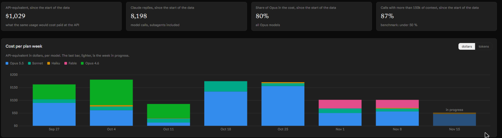
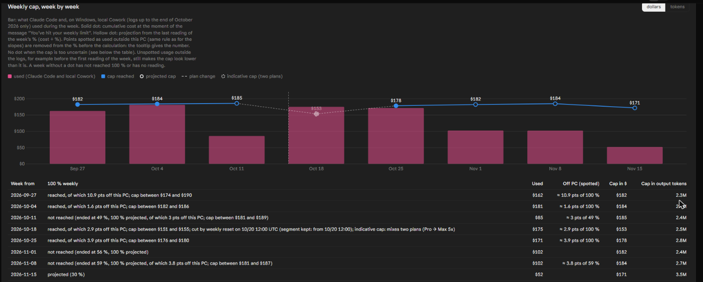
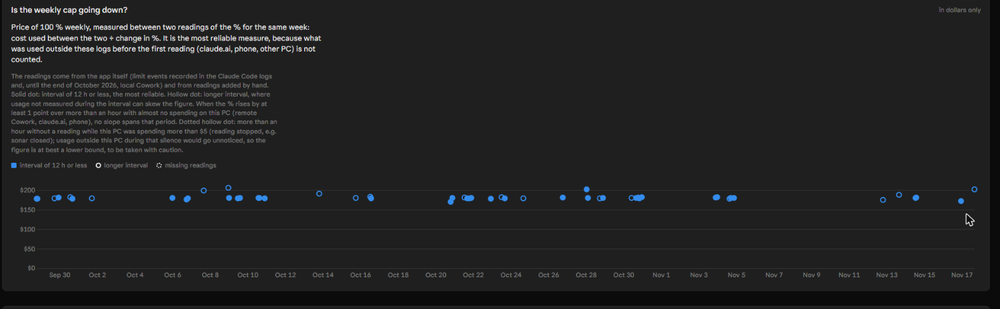

# conso-tokens

**English** · [Français](README.fr.md)

A local dashboard of your Claude Code usage: what your sessions would cost at public API prices, per week of your plan,
per day, per working folder, per model and per session, plus an estimate of your **weekly plan cap in dollars** built
from the usage percentage the app shows.

It reads only the token counters and timestamps of the Claude Code logs (and, on Windows, the Cowork local ones if present) on your machine, **never the content of your
conversations** (one exception: the limit banner of the app's own `<synthetic>` messages, to date limit hits), and everything stays on your machine (except what you choose to publish).

Companion project: [**sonar**](https://github.com/Gh0st113/sonar), a mod for the Code tab of Claude Desktop. Its
quota log (`~/.claude/sonar/quota-log.jsonl`) gives this dashboard the usage percentage readings it needs to estimate the
weekly cap. Without sonar, the readings come from the Claude Code logs (and, until late October 2026, from Cowork local: fewer of them), plus
those you write yourself in `readings.json` (see Manual readings below).

> The code, comments and console output are in French (except the help of `conso-tokens help`). The dashboard page exists in French and in English: an FR / EN button switches it, and by default it follows the browser language.



<sub>Screenshots made from **simulated data** (see [Try it with simulated data](#try-it-with-simulated-data)), not real usage.</sub>

## What you get

- Cost per plan week, stacked by model (the legend follows whatever models appear in your logs).
- Cost per day, per folder, per model, top 30 sessions; a "dollars / tokens" switch on most cost charts (the slope chart stays
  in dollars, the weekly cap table shows both units, the context chart counts calls).
- Weekly cap: price of 100 % of the weekly limit, measured between two readings of the same week at least 8 points apart, and per week
  (reached, projected, or too uncertain), with usage made outside this PC (claude.ai, phone, remote Cowork) spotted and
  removed when the percentage rises while nothing is spent here.
- 5-hour cap: price of 100 % of a 5-hour window, when it was reached or projected from a reading of 50 % or more.
- Context size per call (share of calls above 150k tokens).
- Where the tokens go: share of cache reads, cache writes, output and fresh input, in volume and in cost.
- The folder, model, context, token-type, cache-rebuild and session views follow one period switch: 7 days, 30 days
  or all.
- Advisor tokens (Fable, Mythos…) counted under the advisor's own model, next to the answer's main model.
- Consistency checks run after every export: one line, `CONTRÔLES : OK`, or a precise list of what is wrong
  (and, in a clone, a `DÉPÔT` line if a file of the repository changed).





## Requirements

- Node.js 20 or later, no dependency to install.
- Claude Code logs in `~/.claude/projects` (on Windows, Cowork local sessions are read **if present**; since late October 2026 Cowork no longer writes them on the PC, so its usage is counted as outside this PC, deduced; Cowork is not read on macOS or Linux).

## Install

**With npm** (simplest, no clone). Settings and data go to `~/.conso-tokens/`:

```
npm install -g conso-tokens
conso-tokens update     # reads the logs and builds the dashboard data
conso-tokens page       # where the dashboard page and its data are
```

Update later with `npm update -g conso-tokens`. On Windows, if PowerShell refuses to run `conso-tokens`, type
`conso-tokens.cmd` instead (see [As a command](#as-a-command-conso-tokens)). Next: [Displaying the dashboard](#displaying-the-dashboard). Already using a clone?
Read "Moving from a clone to the package" in [As a command](#as-a-command-conso-tokens) first.

**From a clone**, to read or change the code or run the tests: see [Use](#use) just below.

## Use

From a clone:

```
git clone https://github.com/Gh0st113/conso-tokens
cd conso-tokens
node agreger.mjs        # reads the logs → data/donnees.json (and a counter archive)
node exporter.mjs       # → data/export/*.json (14 tables + _tables.json, their list) + the CONTRÔLES line
node --test             # tests
```

Paths above are for the default data folder `data/` (ignored by git). A clone that already has a `donnees/` folder keeps
using it, with no change; with `dataDir` set, use that folder instead.

### As a command (`conso-tokens`)

The same scripts can be run as one command from any folder, once installed with npm (see [Install](#install)). From a
clone, `npm link` (run once in the clone) puts `conso-tokens` in your PATH instead; the code, `config.local.json` and
`data/` stay in the clone.

```
conso-tokens update     # aggregate then export (export is skipped if aggregate fails)
conso-tokens aggregate  # same options as node agreger.mjs (--logs, --output, --quota-log, …)
conso-tokens export
conso-tokens prices     # node maj-tarifs.mjs (--page <file>: read a saved copy of the Pricing page)
conso-tokens page       # path of the dashboard page and of the export/ folder
conso-tokens help       # the list of commands (also --help, -h)
conso-tokens --version  # the installed version (also -v)
```

`update` refuses `--output` (the export would read the old `donnees.json`): use `aggregate --output` instead.

The old French names still work: `maj`, `agreger`, `exporter`, `tarifs`, `aide`, and the options `--journaux`, `--sortie`,
`--journal-quota`; so do the old keys of `config.local.json` (see below). Nothing has to be renamed.

**Where settings and data go.** Run from a clone (a folder holding `.git`, `config.local.json` or `donnees/`), nothing
changes: everything stays in the clone. Installed as a package, `config.local.json`, `data/` and an updated
`tarifs.json` go to `~/.conso-tokens/` instead, so that an update of the package never touches them. The environment
variable `CONSO_TOKENS_DIR` (an absolute path, or one starting with `~/`) replaces that folder in both cases. If the folder holds both `data/` and `donnees/` and no
`dataDir` (or `dossierDonnees`) is set, the data commands (`update`, `aggregate`, `export`) stop before writing anything: keep one of the two.

**Moving from a clone to the package**: **before** the first `conso-tokens update`, copy the clone's `config.local.json`
into `~/.conso-tokens/`. If the data were in the clone's `data/` (or `donnees/`) folder, or at a relative `dataDir`,
copy that data folder too (to `~/.conso-tokens/data/`, or to the same relative place); an absolute or `~/…` `dataDir`
keeps pointing at the same data. If you ran `node maj-tarifs.mjs` in the clone, copy its
`tarifs.json` too: it keeps the price of models since removed from the Pricing page. The counter archive in `data/` (or `donnees/`) keeps answers whose logs
Claude Code has since deleted: a new archive cannot get them back. The first run with no archive says so.

**Windows**: if PowerShell refuses to run scripts (execution policy), it also refuses the `conso-tokens.ps1` launcher
that npm creates: type `conso-tokens.cmd` instead (and `npm.cmd link`).

`node --test` runs the tests of the calculations and of the page's wording (on small hand-written examples) and
of the price parser, then checks your own exported data: those data tests are skipped until
`agreger.mjs` and `exporter.mjs` have run, and each one that needs more history than you have (several weeks, a few slopes) is
skipped too. A failing data test means your export looks inconsistent, or has a point to check (an `À VÉRIFIER` line):
read its message.

Optional cross-check, from a clone only (not in the npm package): `node comparer-ccusage.mjs` (after `agreger.mjs`) runs [ccusage](https://github.com/ryoppippi/ccusage)
(pinned version, downloaded by `npx` the first time, so it needs the network) on the same logs and prints `CCUSAGE : OK`
or each day whose token counts or cost differ. It writes nothing. ccusage counting less on old days is expected (deleted logs
kept in the archive, `--logs`, Cowork local), and so is a little less cache write on answers that used an advisor (the pinned
version predates ccusage's fix); ccusage counting more means answers this dashboard does not count.

Optional settings: copy `config.exemple.json` to `config.local.json` (ignored by git):

| Key (old name, still accepted) | Meaning |
|---|---|
| `dataDir` (`dossierDonnees`) | where data goes (default `data/` next to `config.local.json`, or `donnees/` if only that one exists; `~/…` accepted, a relative path starts from the folder of `config.local.json`). Inside the repository only `data/` and `donnees/` are accepted, and nothing inside the installed package: anything else stops the script |
| `projectPattern` (`motifProjet`) | regular expression whose group 1 turns a log folder key into a short folder name |
| `renameProjects` (`renommerProjets`) | `[[regex, name], …]` tried first, e.g. to show a sensitive folder under a neutral name |
| `weeklyReset` (`remiseAZero`) | day and UTC hour of the weekly reset: `{ "day": "monday", "hourUTC": "08:00" }` (day name in French or English, `HH:MM`). Default: Sunday 10:00 UTC. A change re-cuts the whole history: the keys of `resets` must then be week starts of the new cycle |
| `resets` | limit resets you used, two forms (see below): `{ "YYYY-MM-DD": "when" }` (whole week) or a list `[{ "when": "YYYY-MM-DDTHH:MMZ", "type": "weekly", "note": "…" }]` (exact time, week cut) |
| `gaps` (`trous`) | periods whose logs you know are missing: `[["first day", "last day", "reason"]]` |
| `plans` (`forfaits`) | plan changes you declare by hand: `{ "YYYY-MM-DD": "plan" }`, applied to the whole week containing the date (see below) |
| `cache` | cache rebuilds, for the main conversation (`main`) and subagents (`subagents`): `{ "main": { "ttl": "auto", "minWrite": 20000 }, "subagents": { "ttl": "auto", "minWrite": 10000 } }` (the defaults). `ttl`: `auto` reads the cache lifetime from the logs, call by call (5 min wins when a call writes both), `5m` or `1h` forces it; `minWrite`: tokens written to the cache from which a lost cache counts as a rebuild. A rebuild is a reply that reads back less than half of the previous reply's context in its thread; cause, in this order: compaction of the thread (the summary is written: unavoidable, shown apart from the losses), pause longer than the cache, model change, instructions or tools changed (an `api-request-shape` line with a different hash, most often tools loaded during the session), other |

Each setting can be written under its English name or its old French name, not both: giving both stops the script with
a message naming them (`cache`, newer, has only its English name). Inside `weeklyReset`, `day` and `hourUTC` (or `jour`
and `heureUTC`) can be mixed, but not both names for the same field.

**Limit resets** (`resets`). The old form (an object `{ "YYYY-MM-DD": "when" }`) marks the whole week as "reset used", with no cap: that is the original behaviour. The new form gives the exact time, in UTC, with the `Z`:

```json
"resets": [{ "when": "2026-01-06T19:30Z", "type": "weekly", "note": "reset used on Tuesday evening" }]
```

- `when` (required; old name `quand`): `YYYY-MM-DDTHH:MMZ`. Seconds are refused, and so is a date without `Z`.
- `type` (required): `"weekly"` (or the old `"hebdo"`); only this type is accepted for now.
- `note` (optional): free text shown on the page.

In either form, an invalid value stops the script with a `config.local.json : resets…` message (old form: each key
must be a real `YYYY-MM-DD` day that starts a week of the cycle). With the new form, **the week is cut** into segments, one per reset: the cap and the output of the week are computed on the retained segment (the one with the largest local %, the most recent on a tie), with its own cost; slopes never join two segments; the status of the week mentions the cut. Assumption: a reset on demand does not move the end of the week (one case observed).

**Detection**: if the weekly % drops by 3 points or more without a declared reset, outside plan-change weeks, and the next reading confirms the drop, `CONTRÔLES` reports `reset probable … non déclaré dans « resets »` (the French wording is kept on purpose: the check output is in French). An isolated drop (a single reading) is not reported. Nothing is corrected automatically. The highest % is taken within the segment only: a declared reset resets the maximum for the readings that follow it.

**Plan changes** (`plans`, old name `forfaits`). The plan (Pro, Max 5x…) is **not detected automatically**: the logs do not contain it, and no credentials file is read. Declare each change yourself, with the first day of the new plan; the whole week containing that day is the new plan:

```json
"plans": { "2026-01-04": "Pro", "2026-01-13": "Max 5x" }
```

- The week of a date uses the reset time of that day: with the default Sunday 10:00 UTC cycle, a reset day belongs to the **new** week, whatever the hour of the cycle.
- The label is free text: 1 to 40 characters, letters, digits, spaces and `. + -` (no parentheses or `%`, which would make the status sentence ambiguous). Leading and trailing spaces are ignored and `Pro` / `pro` are the same plan. The label **is published on the page**: never put a personal name (employer, client…) in it.
- A **change** (a label different from the previous entry) makes its week a *change week*. Its cap is computed as usual but marked `plafond indicatif : mêle deux forfaits (A → B)`: the week mixes two limits, so the figure is shown but **never compared** with the other weeks (neither in the plausibility band nor in the cap line of the page). To get a clean cap for that week, declare the reset hour of the change as a precise reset in `resets`: the week is then cut, and the indicative mark stays.
- Weeks before the first entry have no plan: they form a group of their own in the plausibility band. Without the key, nothing changes.
- **Team** plans: the limit depends on the seat (Standard or Premium), so write it in the label (`"Team Premium"`). **Enterprise** (usage at API prices) and any plan without a weekly % limit: without a % reading, no cap is estimated; the table shows the amount consumed, as before.
- An invalid entry stops the script with a `config.local.json : forfaits…` message.

Logs from another PC: `node agreger.mjs --logs <path to its .claude/projects>` (repeatable; `--journaux` still works).

**Manual readings** (optional): without sonar, you can add usage percentages yourself in `readings.json` (old name
`releves.json`, still read; keep only one of the two names, or the script stops) in the data folder, a list of readings in UTC (`hebdo` = weekly %, `cinqH` = 5-hour %, each with the reset time the app shows):

```json
[{ "ts": "2026-01-07T18:30:00Z", "hebdo": 42, "hebdoReset": "2026-01-11T10:00:00Z", "cinqH": 15, "cinqHReset": "2026-01-07T21:00:00Z" }]
```

A percentage under 10 is ignored (too noisy); the other percentage of the same reading is still used. A file that cannot be read is reported and skipped.

**Prices**: `tarifs.json` lists every model of the official [pricing page](https://platform.claude.com/docs/en/about-claude/pricing).
When a model comes out or changes price, run `node maj-tarifs.mjs`: it rereads the page and never touches `tarifs.json` if
the page looks different from what it expects.

Claude Code deletes sessions untouched for 30 days by default (`cleanupPeriodDays`). The counter archive keeps every
answer already counted, but an answer is counted only if its log still existed at the time of a run: raise that setting if you
want a long history.

## Displaying the dashboard

`page/index.html` is the page of a **claude.ai Dashboard artifact**, not a standalone web page: it relies on the
chart library and data loader that claude.ai provides, so **opening it directly in a browser shows the layout and texts, but no data and no chart**.

1. In the Claude desktop app, open the **Code** tab in this folder.
2. Ask: *"Create a private Dashboard artifact from `page/index.html`, with the 14 tables of `data/export/` as its
   datasets, each named after its file"* (not `_tables.json`, which only lists them) (`semaines`, `jours`, `projets`, `modeles`, `sessions`, `types`, `contexte`,
   `plafondsHebdo`, `plafonds5h`, `pentes`, `reglages`, `resets`, `reconstructions`, `forfaits`).
3. After each new export: *"Reload the 14 datasets of my dashboard from `data/export/`"*. Each reload stores 14 new
   files in the artifact and leaves the previous ones unused (an artifact holds at most 5,000 files). To tidy up now and
   then: *"Delete the files of my dashboard's storage that no dataset points to, keeping those of the last two reloads"*.
4. After an update of `page/index.html`: *"Republish `page/index.html` on my dashboard and check it"*. Open the
   dashboard when asked and show each view once (FR, EN, dollars, tokens): claude.ai checks the page while it is open
   (texts, labels, values shown), and Claude reads the result (`passed`, or the list of faults).

**Upgrading to 0.3.0 or later**: the exports now hold codes and numbers instead of French sentences (the page writes
the sentences). Republish the page from the new `page/index.html`, then run a new export and reload the 14 datasets.
The new page still reads old exports, but an old page cannot read the new ones: update the page first.

**After 0.3.2**: the `types` dataset has one row per day with usage and per token type (for the period switch). Same order:
republish the page first, then reload the datasets; an older page would list every day and type separately.

With the `conso-tokens` command, `conso-tokens page` prints where the page and the `export/` folder are.

Keep the artifact private: whoever opens it can read the files (folder names, costs, sessions).

## Adding a language

The page has two languages, French (the reference, the text of the HTML) and English, and the FR / EN buttons are built
from one table. To add a language (the example below is `zh`, a scenario only: nothing is translated here):

1. In `page/index.html`, `<script id="dico">`: add an entry to `LANGUES`, e.g. the example entry below. The button appears by itself.
2. Same file, `<script id="libelles">`: add the same key to `PHRASES` (same keys as `fr`: the tables `types`, `tranches`, `causes`, `fils`, and every phrase function).
3. Same `#dico` script: add a `zh` key to each `DICO` entry (`tr()` texts and `aria-label`s).
4. Fixed texts of the HTML carry every language themselves: next to each `<span lang="en">…</span>`, add a
   `<span lang="zh">…</span>` (same class when it has one: `cc-usd` / `cc-jet` are the dollars / tokens variants), and in the
   `<style>` add `.cc:not(.cc-lang-zh) [lang="zh"]` to the rule that hides the other languages. The platform does not let a
   script write text outside a drawing (#34): the page only switches classes on `.cc`.
5. Run `node --test`: it names what is missing (`zh : phrase « coupee »`, `zh : texte fixe « Conso Claude Code »`, …). A language left incomplete fails the tests.

Example entry (`zh`, an illustration only):

```js
zh: { locale: 'zh-CN', decimal: '.', sep: ': ', monnaie: n => '$' + n, heureInfo: s => s, heureUTC: (h, m) => `${h}:${m} UTC` }
```

Nothing else changes in the logic: it reads the tables. The titles and descriptions of the summary tiles (`dash.calc`)
stay in English: the platform reads them, and the FR / EN buttons do not change them. The test « page : aucune langue en dur… » in `libelles.test.mjs`
fixes the list of languages (`['en', 'fr']`): it must list the new code too. The default language is the browser's language if it is in `LANGUES` (its
prefix, `zh-CN` → `zh`), otherwise `en`.

## Try it with simulated data

`demo/generer-demo.mjs` writes a fake home folder: eight weeks of Claude Code logs (invented folders, fixed random
seed) and a matching sonar quota log, with a weekly cap of about 180 $. It is how the screenshots above were made.
Run it in a **second clone** of this repository (with its `.git`) without `config.local.json`, so the results land in the copy's `data/`,
not in your own data folder:

```powershell
node demo/generer-demo.mjs ../demo-home
$env:USERPROFILE = (Resolve-Path ../demo-home); node agreger.mjs; node exporter.mjs
```

On macOS / Linux: `HOME=../demo-home node agreger.mjs && HOME=../demo-home node exporter.mjs`. Then display
`data/export/` as described above. Close that PowerShell window afterwards (its `USERPROFILE` is changed).

## Limits

- "API equivalent" is an order of magnitude to compare weeks, not how the plan is billed nor the percentage of `/usage`.
- The weekly reset is set by the `weeklyReset` key (old name `remiseAZero`; default **Sunday 10:00 UTC**), one cycle for the whole history.
  Calendar days stay in the **Europe/Paris** time zone and are not configurable.
- Usage outside this PC is deduced from whole-number percentages, not measured: when such periods are spotted, the
  weekly cap is given as a range, otherwise as a single estimate; no cap at all when the share paid on this PC is under
  10 % or the range is wider than 25 % of the cap.
- Known limits of the reset detection: readings under 10 % are ignored, so a drop that leaves the % under 10 until the end of the week is not reported; a single odd reading stays in the slopes; a single abnormally **high** reading (e.g. 40, 100, 30, 28 %) can wrongly give a "probable reset" (a "to check" line, never a correction). A reset declared at the exact instant of the cycle's own reset is ignored (it cuts nothing).
- Advisor tokens are counted since 0.3.1. Answers whose logs Claude Code had already deleted stay in the archive as
  they were counted before (no advisor, cache write split of the first step only): that cannot be recovered.
- Subagent answers archived before late November 2026 carry no agent name: they count in the totals but cannot be
  classified as cache rebuilds.
- Plan changes (`plans`) are dated to the week, not to the hour: the whole week is left out of the comparisons and its cap is only indicative. An undeclared plan change is not detected: the plans are mixed, as before.

## License

MIT
