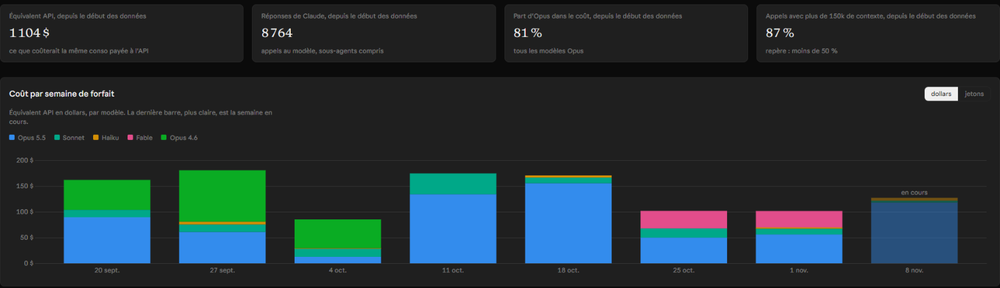
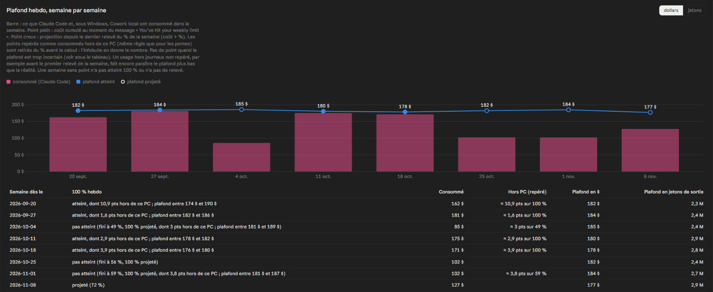
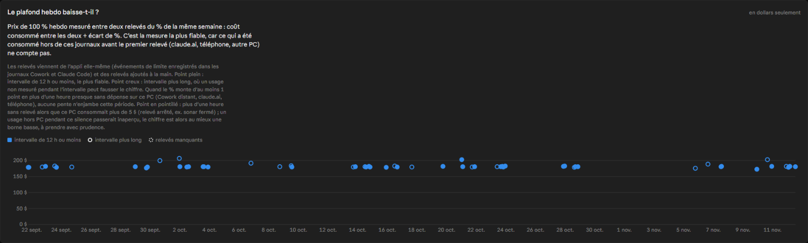

# conso-tokens

**English** · [Français](README.fr.md)

A local dashboard of your Claude Code usage: what your sessions would cost at public API prices, per week of your plan,
per day, per working folder, per model and per session, plus an estimate of your **weekly plan cap in dollars** built
from the usage percentage the app shows.

It reads only the token counters and timestamps of the Claude Code logs on your machine, **never the content of your
conversations**, and everything stays on your machine (except what you choose to publish).

Companion project: [**sonar**](https://github.com/Gh0st113/sonar), a mod for the Code tab of Claude Desktop. Its
quota log (`~/.claude/sonar/quota-log.jsonl`) gives this dashboard the usage percentage readings it needs to estimate the
weekly cap. Without sonar, only the readings Claude Code writes into its own logs are used (fewer of them).

> The code, comments and dashboard text are in French.



<sub>Screenshots made from **simulated data** (see [Try it with simulated data](#try-it-with-simulated-data)), not real usage.</sub>

## What you get

- Cost per plan week, stacked by model (the legend follows whatever models appear in your logs).
- Cost per day, per folder, per model, top 30 sessions; a "dollars / tokens" switch on most cost charts (the slope chart stays
  in dollars, the weekly cap table shows both units, the context chart counts calls).
- Weekly cap: price of 100 % of the weekly limit, measured between two readings of the same week, and per week
  (reached, projected, or too uncertain), with usage made outside this PC (claude.ai, phone, remote Cowork) spotted and
  removed when the percentage rises while nothing is spent here.
- Context size per call (share of calls above 150k tokens).
- Consistency checks run after every export: one line, `CONTRÔLES : OK`, or a precise list of what is wrong.





## Requirements

- Node.js 20 or later, no dependency to install.
- Claude Code logs in `~/.claude/projects` (on Windows, Cowork local sessions are read too; not on macOS or Linux).

## Use

```
git clone https://github.com/Gh0st113/conso-tokens
cd conso-tokens
node agreger.mjs        # reads the logs → donnees/donnees.json (and a counter archive)
node exporter.mjs       # → donnees/export/*.json (10 tables) + the CONTRÔLES line
node --test             # tests
```

Paths above are for the default data folder `donnees/` (ignored by git); with `dossierDonnees` set, look there instead.

`node --test` runs the price-parser tests, then checks your own exported data: those data tests are skipped until
the two commands above have run, and each one that needs more history than you have (several weeks, a few slopes) is
skipped too. A failing data test means your export looks inconsistent: read its message.

Optional settings: copy `config.exemple.json` to `config.local.json` (ignored by git):

| Key | Meaning |
|---|---|
| `dossierDonnees` | where data goes (default `donnees/` in this folder; `~/…` accepted). Keeping it outside the repository is safer |
| `motifProjet` | regular expression whose group 1 turns a log folder key into a short folder name |
| `renommerProjets` | `[[regex, name], …]` tried first, e.g. to show a sensitive folder under a neutral name |
| `resets` | weeks where you used a limit reset: `{ "YYYY-MM-DD": "when" }`, the date being the Sunday that opens the week |
| `trous` | periods whose logs you know are missing: `[["first day", "last day", "reason"]]` |

Logs from another PC: `node agreger.mjs --journaux <path to its .claude/projects>` (repeatable).

**Manual readings** (optional): without sonar, you can add usage percentages yourself in `releves.json` in the data
folder, a list of readings in UTC (`hebdo` = weekly %, `cinqH` = 5-hour %, each with the reset time the app shows):

```json
[{ "ts": "2026-01-07T18:30:00Z", "hebdo": 42, "hebdoReset": "2026-01-11T10:00:00Z", "cinqH": 15, "cinqHReset": "2026-01-07T21:00:00Z" }]
```

A percentage under 10 is ignored (too noisy); the other one of the same reading is still used. A file that cannot be read is reported and skipped.

**Prices**: `tarifs.json` lists every model of the official [pricing page](https://platform.claude.com/docs/en/about-claude/pricing).
When a model comes out or changes price, run `node maj-tarifs.mjs`: it rereads the page and refuses to write anything if
the page looks different from what it expects.

Claude Code deletes sessions untouched for 30 days by default (`cleanupPeriodDays`). The counter archive keeps every
answer already counted, but runs are only as complete as the logs were when they happened: raise that setting if you
want a long history.

## Displaying the dashboard

`page/index.html` is the page of a **claude.ai Dashboard artifact**, not a standalone web page: it relies on the
chart library and data loader that claude.ai provides, so **opening it directly in a browser shows nothing**.

1. In the Claude desktop app, open the **Code** tab in this folder.
2. Ask: *"Create a private Dashboard artifact from `page/index.html`, with the 10 files of `donnees/export/` as its
   datasets, each named after its file"* (`semaines`, `jours`, `projets`, `modeles`, `sessions`, `types`, `contexte`,
   `plafondsHebdo`, `plafonds5h`, `pentes`).
3. After each new export: *"Reload the 10 datasets of my dashboard from `donnees/export/`"*.

Keep the artifact private: whoever opens it can read the files (folder names, costs, sessions).

## Try it with simulated data

`demo/generer-demo.mjs` writes a fake home folder: eight weeks of Claude Code logs (invented folders, fixed random
seed) and a matching sonar quota log, with a weekly cap of about 180 $. It is how the screenshots above were made.
Run it in a **copy** of this repository without `config.local.json`, so the results land in the copy's `donnees/`,
not in your own data folder:

```powershell
node demo/generer-demo.mjs ../demo-home
$env:USERPROFILE = (Resolve-Path ../demo-home); node agreger.mjs; node exporter.mjs
```

On macOS / Linux: `HOME=../demo-home node agreger.mjs && HOME=../demo-home node exporter.mjs`. Then display
`donnees/export/` as described above. Close that PowerShell window afterwards (its `USERPROFILE` is changed).

## Limits

- "API equivalent" is an order of magnitude to compare weeks, not how the plan is billed nor the percentage of `/usage`.
- The weekly reset is fixed at **Sunday 10:00 UTC** and days are calendar days in the **Europe/Paris** time zone. Neither
  is configurable yet: they are spread over the scripts and the page.
- Usage outside this PC is deduced from whole-number percentages, not measured: when such periods are spotted, the
  weekly cap is given as a range, otherwise as a single estimate; no cap at all when the share paid on this PC is under
  10 % or the range is wider than 25 % of the cap.

## License

MIT
